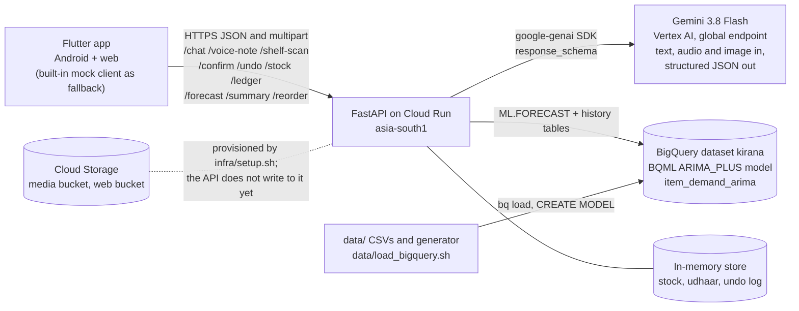

# Kirana Mitra

**Bolo, ho jayega.** A voice- and photo-first assistant for small Indian grocery shops (kiranas).
Entry to the Google Cloud AI Builder Cup, **Retail & Commerce** track, by team **singapuria_innovators**.

## What it does (for a judge, in five lines)

1. The shopkeeper speaks a voice note or types in Hindi, Hinglish or English ("Kal Parle-G ke 3 carton aaye", "Gupta ji ne 350 rupaye udhaar liya"). Gemini 3.8 Flash on Vertex AI returns structured JSON that becomes a stock or udhaar (credit) entry, with a confirmation and an Undo button.
2. A shelf photo is counted by Gemini vision; the counts are held until the shopkeeper taps "Haan, update karo", then stock is set to what the photo shows.
3. BigQuery ML `ARIMA_PLUS` forecasts the next 4 weeks of demand per item, with a festival uplift (Dussehra, Diwali) on top, and turns it into a reorder list.
4. The reorder list is a ready-to-send WhatsApp message (a `wa.me` link; nothing is sent automatically).
5. An evening "hisaab" summary (sales, udhaar given and received, money outstanding, low stock) comes back in the shop's own language.

Measured numbers are in [`docs/submission/performance-report.md`](docs/submission/performance-report.md); the two-minute demo is in [`docs/submission/demo-script.md`](docs/submission/demo-script.md); the pitch outline is in [`docs/submission/pitch-outline.md`](docs/submission/pitch-outline.md).

| | |
|---|---|
| Cloud Run API | `<CLOUD_RUN_URL>` (set after `infra/deploy.sh`; `curl <CLOUD_RUN_URL>/health` should return `{"ok":true,...}`) |
| Web demo | `<WEB_DEMO_URL>` (set after `infra/deploy_web.sh`, which prints `https://storage.googleapis.com/<bucket>/index.html`) |
| Android APK | not built or hosted; see [Android](#android) |
| Project / region | `kirana-mitra-app` / `asia-south1` (Gemini is called through the `global` endpoint) |

## Architecture



How one message flows: the app posts text, audio bytes or an image; `backend/app/gemini.py` sends it to Gemini with a few-shot system prompt and `response_schema`, so the reply is always valid JSON (intent, confidence, language, transcript, entities, reply text). `backend/app/matching.py` fuzzy-matches spoken item and customer names to the catalogue. `backend/app/service.py` writes the entry when confidence is at least 0.7 (`CONFIRM_THRESHOLD`) and offers Undo; below that it parks the entry and asks "Haan, add karo". Details: [`backend/README.md`](backend/README.md). The frozen API is [`docs/api-contract.md`](docs/api-contract.md).

## Repository layout

| Folder | What lives there |
|---|---|
| `app/` | Flutter app (Android and web): onboarding, chat, stock, udhaar (plus a per-customer screen), forecast; `MockApiClient` fallback. See [`app/README.md`](app/README.md). |
| `backend/` | FastAPI service, Dockerfile, unit tests, eval harnesses. See [`backend/README.md`](backend/README.md). |
| `data/` | 40-item catalogue, festival calendar and uplift table, 120-day synthetic sales generator, BigQuery load script and BQML SQL, measured results. See [`data/README.md`](data/README.md). |
| `infra/` | gcloud setup, deploy, web publish and teardown scripts, env template. See [`infra/README.md`](infra/README.md). |
| `docs/` | API contract, design handoff, submission documents. |

## Run it locally

Prerequisites: [uv](https://docs.astral.sh/uv/) (`brew install uv`), Flutter (Dart SDK `^3.12.1`, see `app/pubspec.yaml`), and for the live paths `gcloud` plus a Google Cloud project.

### 1. Backend (FastAPI)

Offline, no credentials, no cost (a regex stand-in for Gemini; forecast reads the CSVs in `data/`):

```bash
cd backend
uv sync
cp .env.example .env
MOCK_GEMINI=1 uv run uvicorn app.main:app --port 8080 --reload
```

Live Gemini on Vertex AI: edit `backend/.env` (`GOOGLE_CLOUD_PROJECT=<your project>`, keep `MOCK_GEMINI=0`), then:

```bash
gcloud auth application-default login
gcloud services enable aiplatform.googleapis.com
cd backend
uv run uvicorn app.main:app --port 8080 --reload
```

Check it: `curl localhost:8080/health`. Interactive docs are at `http://localhost:8080/docs`. `curl` examples for every endpoint are in [`backend/README.md`](backend/README.md#try-it).

### 2. App (Flutter)

```bash
cd app
flutter pub get
flutter run -d chrome --dart-define API_BASE_URL=http://localhost:8080
```

- At startup the app calls the backend's health route with a 6 s timeout (`app/lib/api/dio_api_client.dart`). If that fails it switches to the built-in mock client and shows a "Demo" badge; the whole flow still works offline.
- Force the mock: `flutter run -d chrome --dart-define USE_MOCK=true`.
- Point at Cloud Run: `--dart-define API_BASE_URL=<CLOUD_RUN_URL>`.
- On the web, voice is recorded as `audio/webm` (Opus) because Chrome cannot encode AAC; the API accepts it.

#### Android

Emulator: `flutter run` with no flags works, the app defaults to `http://10.0.2.2:8080` (the emulator's alias for your Mac). A physical phone on the same Wi-Fi needs your Mac's LAN IP:

```bash
cd app
flutter run -d <device-id> --dart-define API_BASE_URL=http://192.168.1.23:8080
```

Release APK (cleartext HTTP is allowed in the manifest for local development; point `API_BASE_URL` at the Cloud Run HTTPS URL for a shareable build). The APK has not been built or published as part of this submission, so no download link exists:

```bash
cd app
flutter build apk --release --dart-define API_BASE_URL=<CLOUD_RUN_URL>
```

The file lands in `app/build/app/outputs/flutter-apk/`. Grant the microphone prompt on first use (`RECORD_AUDIO` is declared in the manifest).

### 3. Data and forecast (BigQuery ML)

The sales history is committed (`data/sales_history.csv`, 4,800 rows), so regenerating is optional:

```bash
uv run data/generate_sales.py
```

See what would run, with no project needed:

```bash
data/load_bigquery.sh --dry-run all
```

For real (needs `PROJECT_ID`, from the shell or from `infra/.env`; `GCLOUD_CONFIG=<name>` in `infra/.env` selects a named gcloud configuration):

```bash
export PROJECT_ID=<your project>
data/load_bigquery.sh load
data/load_bigquery.sh train
data/load_bigquery.sh forecast --shop shp_demo --start 2026-10-19
data/load_bigquery.sh evaluate
```

`load` creates dataset `kirana` in `asia-south1` with the tables and views; `train` creates the `ARIMA_PLUS` model `kirana.item_demand_arima` (about 5 s for 40 series); `forecast` prints 160 rows (40 items by 4 weeks); `evaluate` retrains on history minus 14 days and writes per-item error to `kirana.forecast_eval`. Costs and caveats: [`data/README.md`](data/README.md).

Then run the backend with `FORECAST_SOURCE=bigquery` (the default when `GOOGLE_CLOUD_PROJECT` is set and `MOCK_GEMINI` is off).

## Deploy to Google Cloud

All scripts read `infra/.env` (copy `infra/.env.example`, never commit it), refuse to run without `PROJECT_ID`, and print their commands with `--dry-run`.

```bash
cp infra/.env.example infra/.env     # fill in PROJECT_ID, GCS_BUCKET, GEMINI_MODEL (value in backend/.env.example)
infra/setup.sh --dry-run
infra/setup.sh                       # APIs, Artifact Registry, media bucket, service account and roles
data/load_bigquery.sh all            # dataset, tables, model, forecast, evaluation
infra/deploy.sh --dry-run
infra/deploy.sh                      # Cloud Build + Cloud Run, prints the service URL
```

Put the printed URL into `API_BASE_URL` in `infra/.env`, then publish the web build to a public bucket:

```bash
infra/deploy_web.sh --dry-run
infra/deploy_web.sh
```

- Cloud Run API: `<CLOUD_RUN_URL>`
- Web demo: `<WEB_DEMO_URL>`

Teardown: `infra/teardown.sh` (add `--all` to also remove Cloud Run, Artifact Registry and the BigQuery dataset). Cloud SQL is not created by any default path; see [what is deferred](#what-is-mocked-or-deferred). Order, cost per step and known quirks: [`infra/README.md`](infra/README.md).

## Environment variables

Backend (`backend/.env.example`; `infra/deploy.sh` sets the same names on Cloud Run):

| Var | Meaning |
|---|---|
| `GOOGLE_GENAI_USE_VERTEXAI` | `true`: Vertex AI with Application Default Credentials, not an API key |
| `GOOGLE_CLOUD_PROJECT` | project id |
| `GOOGLE_CLOUD_LOCATION` | `global` (where Gemini 3.x Flash is served) |
| `GEMINI_MODEL` | `gemini-3.8-flash` |
| `MOCK_GEMINI` | `1`: offline regex extractor, canned shelf scan, local forecast; no credentials |
| `CONFIRM_THRESHOLD` | default `0.7`; below it an entry waits for a confirm tap |
| `FORECAST_SOURCE` | `bigquery` or `local`; default `bigquery` when a project is set and the mock is off |
| `BQ_DATASET`, `BQ_LOCATION` | `kirana`, `asia-south1` |
| `DATA_DIR` | folder with the four CSVs for the local forecast; default `../data` |

Infra (`infra/.env.example`): `PROJECT_ID`, `REGION`, `GCS_BUCKET`, `WEB_BUCKET`, `CLOUD_RUN_SERVICE`, `CLOUD_RUN_SA`, `AR_REPO`, `API_BASE_URL`, `GCLOUD_CONFIG`, plus the backend names above passed through. Cloud SQL names (`CLOUDSQL_*`) are only used with `--with-cloudsql`.

App (compile-time, `--dart-define`): `API_BASE_URL`, `USE_MOCK`.

## Tests and evaluation

Unit tests (Gemini scripted, no network):

```bash
cd backend
uv run pytest -q
```

Voice/text entry eval, 26 utterances against a running server; appends a row to `backend/tests/eval/results.csv`:

```bash
cd backend
uv run python -m tests.eval.run --base http://localhost:8080
```

Shelf-scan eval, 5 synthetic images with exact counts; appends to `backend/tests/eval/shelf/results.csv`:

```bash
cd backend
uv run python -m tests.eval.shelf.run --base http://localhost:8080
```

Forecast holdout: `data/load_bigquery.sh evaluate` (results copied into `backend/tests/eval/forecast_results.csv` and written up in `data/bqml/results.md`).

## What is mocked or deferred

- **In-memory store.** Stock, udhaar, undo history and shops live in a Python object (`InMemoryRepository`, seeded with 15 common kirana items). They disappear on restart, and on Cloud Run with `--min-instances 0` also when the instance scales to zero; the app then shows "shop ... not found" and the menu's "Change shop" re-onboards.
- **Cloud SQL is deferred.** The `Repository` interface in `backend/app/store.py` is the seam for it. `infra/setup.sh --with-cloudsql` and `infra/deploy.sh --with-cloudsql` exist but have only been dry-run; no instance was created.
- **Synthetic sales.** The 120 days of sales behind the forecast come from `data/generate_sales.py` (seed 42), not from a real shop. Only the demo shop `shp_demo` has history in BigQuery; any other shop id is served that same series, with `on_hand` from its own stock.
- **Synthetic shelf images.** The shelf-scan eval uses 5 Pillow-generated images (no CC-licensed kirana photos with countable units were found). Real shelf photos have not been evaluated.
- **Voice accuracy is measured on text.** The 26-utterance eval posts typed text to `/chat` (and 6 of the 26 sentences are also few-shot examples in the system prompt); the audio path (`/voice-note`, audio bytes sent inline to Gemini) is implemented and unit-tested with a scripted Gemini, but no recorded-audio accuracy or latency number exists.
- **Festival effect is added by hand.** `HOLIDAY_REGION = 'IN'` is set on the model, but BigQuery only models holidays for series longer than a year; with 120 days the festival uplift comes from `data/festival_uplift.csv`, which the generator also used to create the data (see the caveat in the performance report).
- **Cloud Storage is provisioned, not used by the API.** `GCS_BUCKET` is set on the Cloud Run service, but the backend does not store photos or audio; the web build goes to a separate public bucket via `infra/deploy_web.sh`, which has only been dry-run.
- **No scheduled evening push.** The hisaab is fetched on demand from the chat menu ("Aaj ka hisaab"); the 21:30 notification in the design handoff is not implemented.
- **Reorder is a link, not a send.** `/reorder` returns a `wa.me` URL; nothing is sent to a supplier.
- **Open CORS.** The API allows any origin for the demo (`allow_origins=["*"]` in `backend/app/main.py`); tighten before production.

## Known issue at the time of writing

The API contract and Cloud Run use `GET /health`: the `*.run.app` edge answers the exact path `/healthz` with its own 404 before the container sees it. The app's startup check in `app/lib/api/dio_api_client.dart` still calls `/healthz`, so against the Cloud Run URL it will treat the backend as down and start in mock mode ("Demo" badge) until that path is changed to `/health`. Locally both paths work.

## Documents

- [`docs/api-contract.md`](docs/api-contract.md): the frozen v1 API
- [`docs/design/handoff.md`](docs/design/handoff.md): UX handoff; design board linked from [`docs/design/README.md`](docs/design/README.md)
- [`docs/submission/demo-script.md`](docs/submission/demo-script.md), [`performance-report.md`](docs/submission/performance-report.md), [`pitch-outline.md`](docs/submission/pitch-outline.md)

## Team

singapuria_innovators. Google Cloud AI Builder Cup, Retail & Commerce track.
